[README.md](https://github.com/user-attachments/files/34777367/README.md)
# Space Invaders - Power PPlay

Um jogo arcade 2D desenvolvido em Python com Power PPlay 2.0. O projeto parte da estrutura clássica de *Space Invaders* e adiciona progressão de hordas, dificuldades, bônus, inimigos resistentes, ranking persistente e uma demonstração automática controlada por IA.

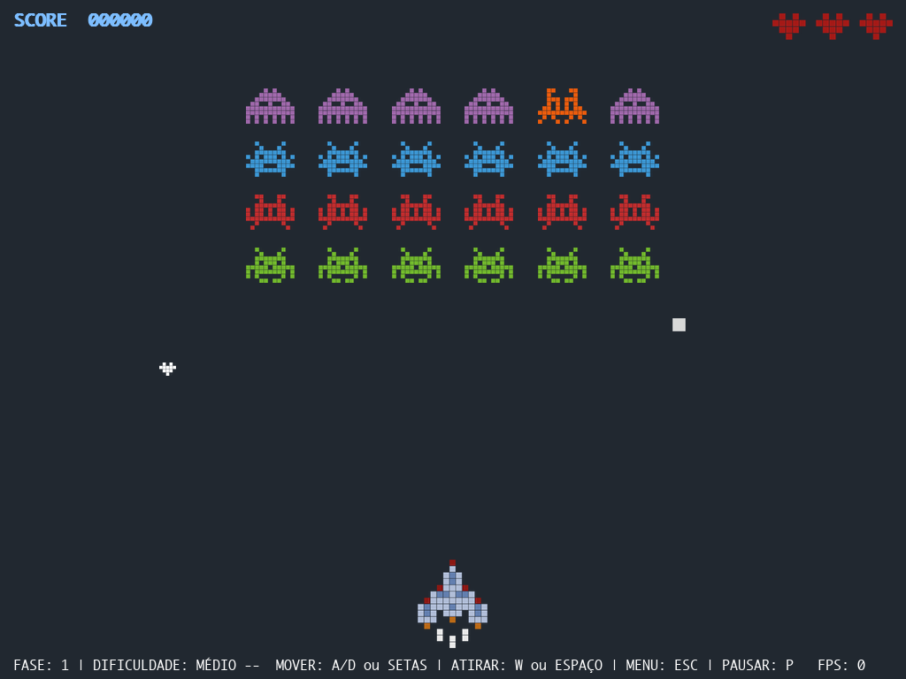

## Destaques

- movimento horizontal com `delta time`;
- múltiplos tiros com recarga;
- formação de monstros em matriz configurável;
- inversão sincronizada e descida da horda;
- cinco tipos de inimigo com ataques e resistências diferentes;
- boss cromático com três fases, seis tiros de resistência e renascimento aleatório;
- ataque especial do boss que elimina uma linha e uma coluna inteiras;
- piscada, explosão e invulnerabilidade;
- três dificuldades;
- ondas progressivas até 7 x 10;
- escudo, tiro duplo, pontos em dobro e desafio 5x;
- coração de vida extra;
- bônus por conclusão rápida da horda;
- pausa com o jogo congelado ao fundo;
- ranking salvo com nome, pontuação e data;
- modo IA decorativo na tela de ranking;
- otimização ampla antes das colisões tiro-monstro.

## Mecânicas em ação

### Inimigos, resistência e pontuação

Cada tipo possui um sprite, uma resistência e uma recompensa. O monstro-surpresa usa a versão branca correspondente, tem vida igual ao seu tipo e vale cinco vezes mais pontos.

| Tipo | Tiros para destruir | Pontos | Tiros no desafio 5x | Pontos no desafio 5x |
|---:|---:|---:|---:|---:|
| 1 | 1 | 10 | 1 | 50 |
| 2 | 1 | 20 | 2 | 100 |
| 3 | 2 | 30 | 3 | 150 |
| 4 | 2 | 40 | 4 | 200 |
| 5 | 3 | 50 | 5 | 250 |

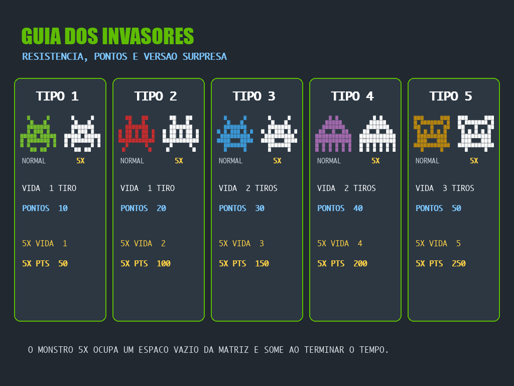

### Boss cromático

O boss nasce em uma célula aleatória da matriz e pode substituir um monstro comum que estiver nela. A posição do monstro-surpresa 5x é preservada. O boss possui três fases visuais e precisa receber seis tiros no total:

| Fase | Sprite | Tiros nesta fase | Transição |
|---|---|---:|---|
| 1 | `boss_1.png` | 1 | Muda após o 1º tiro |
| 2 | `boss_2.png` | 2 | Muda após o 3º tiro total |
| 3 | `boss_3.png` | 3 | Explode após o 6º tiro total |

Cada boss destruído vale 100 pontos base. Enquanto houver outros inimigos, outro boss nasce em uma posição aleatória e pode substituir um monstro. Se ele for o último inimigo, precisa ser destruído para que a próxima horda comece.

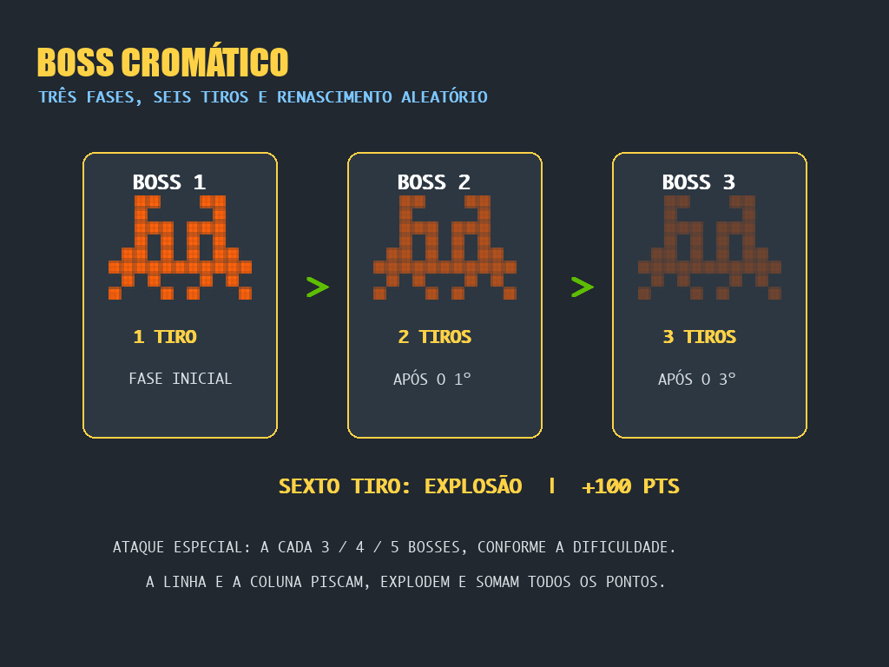

O aviso `+100 PTS` aparece em vermelho ao lado do placar e respeita o multiplicador de pontos.

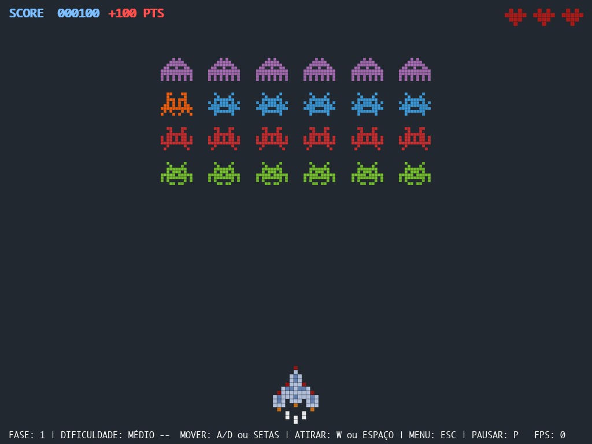

### Ataque especial do boss

O contador de bosses destruídos continua entre as hordas. A cada 3 bosses no fácil, 4 no médio ou 5 no difícil, a derrota do boss também atinge todos os monstros da linha e da coluna em que ele estava. Os alvos piscam, exibem a explosão e desaparecem. O aviso mostra a soma de toda a pontuação recebida como `+X PTS`.

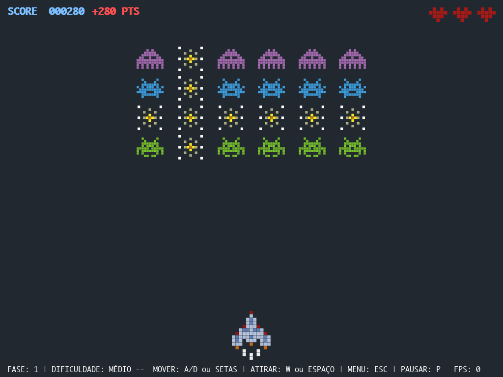

### Tiro duplo

Cria dois projéteis por disparo. O efeito aumenta o dano, mas não dobra os pontos dos monstros.

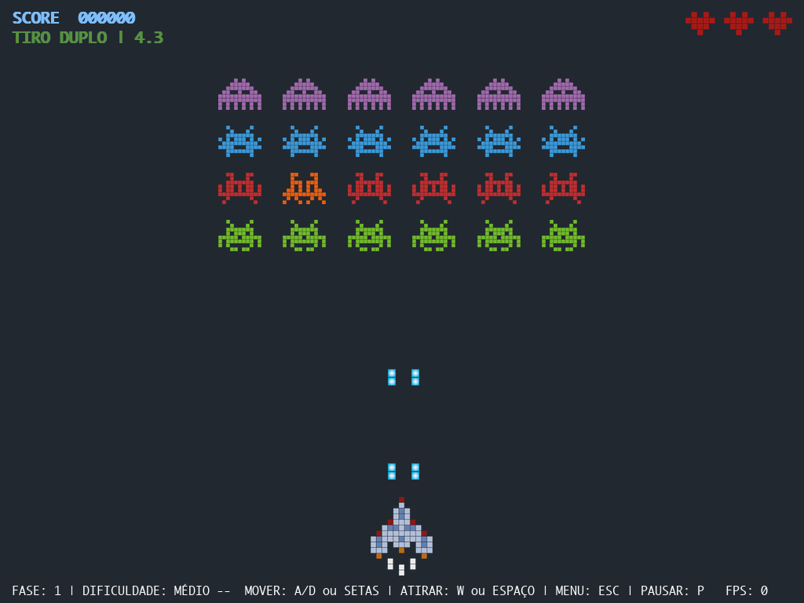

### Escudo

Troca o sprite da nave e impede a perda de vidas enquanto o temporizador estiver ativo.

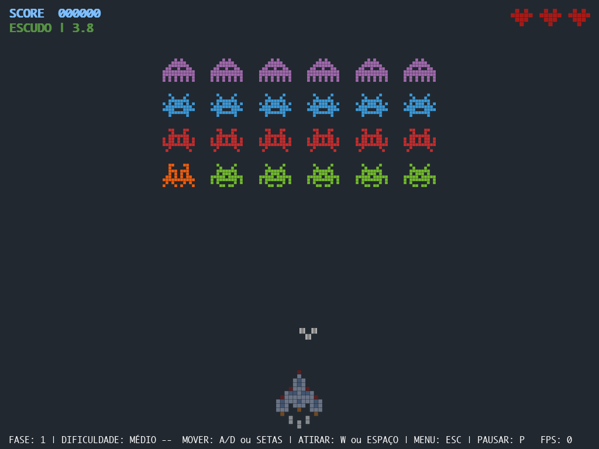

### Monstro-surpresa 5x

Aparece em um espaço vazio da matriz, possui vida igual ao seu tipo e desaparece quando o efeito termina. Se for destruído antes, o desafio acaba imediatamente e a recompensa aparece em vermelho como `+X PTS`.

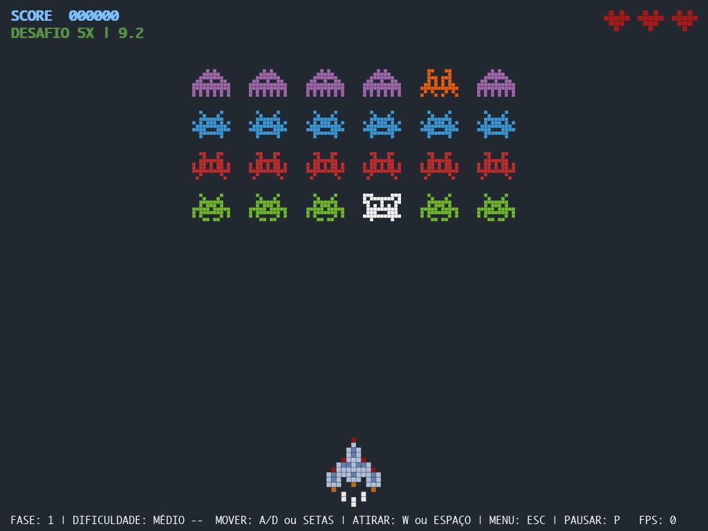

### Horda perfeita

Concluir uma horda em até 30 segundos concede a melhor classificação de tempo e +1000 pontos.

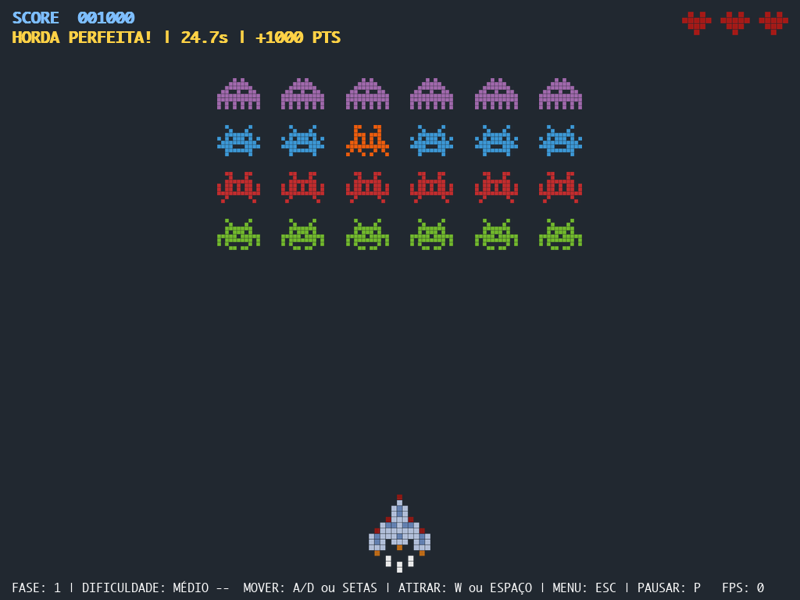

## Capturas

### Ranking e modo IA

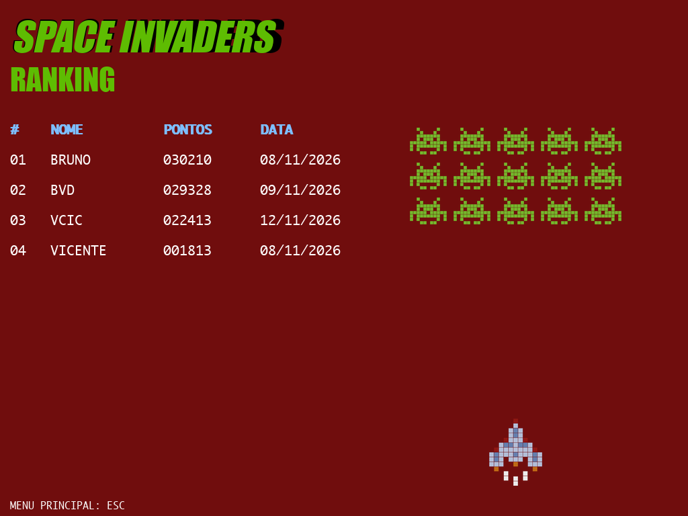

### Game over e recordes

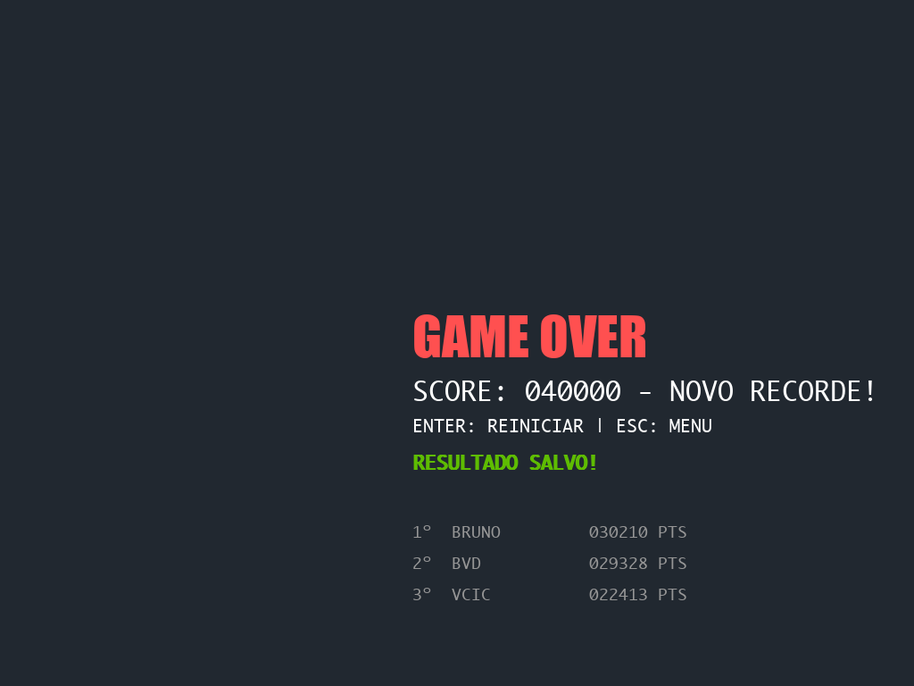

## Controles

| Ação | Teclas |
|---|---|
| Mover | `A` / `D` ou setas esquerda / direita |
| Atirar | `W` ou `Espaço` |
| Pausar | `P` |
| Menu / voltar | `Esc` |
| Confirmar nome / reiniciar | `Enter` |
| Navegar nos menus | Mouse |

## Como executar

### Requisitos

- Python 3;
- Pygame 2.6 ou compatível;
- Power PPlay 2.0 incluída na pasta do projeto.

### Instalação

```bash
python3 -m venv .venv
source .venv/bin/activate
pip install pygame
```

No Windows, a ativação do ambiente virtual é:

```powershell
.venv\Scripts\activate
```

### Execução

Os caminhos das imagens são relativos à pasta `Atividade_2`, portanto execute a partir dela:

```bash
cd Atividade_2
python main.py
```

## Dificuldades

| Nível | Formação inicial | Característica |
|---|---:|---|
| Fácil | 3 x 5 | Menor velocidade e maior intervalo inimigo |
| Médio | 4 x 6 | Pressão intermediária |
| Difícil | 5 x 6 | Inimigos e ataques mais rápidos |

## Bônus

| Bônus | Efeito |
|---|---|
| Tiro duplo | Dois projéteis por disparo |
| Escudo | Bloqueia dano temporariamente |
| 2x pontos | Dobra pontos de inimigos |
| Desafio 5x | Monstro especial em um espaço vazio |
| Vida extra | Recupera uma vida ou vale +5 pontos com vidas cheias |

## Bônus de tempo

- até 30 s: **Horda Perfeita**, +1000 pontos;
- até 45 s: **Horda Relâmpago**, +750 pontos;
- até 60 s: **Horda Rápida**, +500 pontos;
- acima de 60 s: horda concluída sem bônus.

## Estrutura

```text
Atividade_2/
├── main.py              # loop principal e telas
├── tela_jogo.py         # coordenação da partida
├── player.py            # nave e tiros
├── monsters.py          # formação, ataques e colisões
├── bonus.py             # bônus e vida extra
├── ranking.py           # persistência e ordenação
├── jogo_ia.py           # demonstração do ranking
├── tela_*.py            # telas auxiliares
├── imagens/             # sprites e interface
└── PPlay/               # framework incluída
```

## Documentação

- [Game Design Document](docs/GDD.md)
- [GDD em PDF](output/pdf/GDD-Space-Invaders.pdf)
- [Roteiro para publicar no GitHub](docs/GUIA-GITHUB.md)

## Ranking

Os resultados são armazenados localmente em `ranking.txt` no formato:

```text
NOME;PONTUACAO;DATA
```

O arquivo é ordenado em memória para mostrar os cinco melhores resultados. A tela de game over apresenta o top 3 e identifica um novo recorde.

## Contexto acadêmico

Este jogo foi desenvolvido como trabalho da disciplina **Laboratório de Programação de Jogos**, do curso de **Ciência da Computação da Universidade Federal Fluminense (UFF)**, ministrada pelo **professor Esteban Walter Gonzales Clua**.

O projeto acompanha os desafios propostos na disciplina e demonstra listas, matrizes, orientação a objetos, colisões, temporização, persistência em arquivo e otimização de testes de colisão. A progressão de hordas, os bônus, o ranking, o modo IA e os demais elementos visuais foram incorporados como extensões da proposta principal.

O desenvolvimento foi iterativo e utilizou ferramentas de IA como apoio para discussão, revisão e depuração. As decisões de design, integração das mecânicas, testes e ajustes do projeto foram conduzidos pelo autor.

